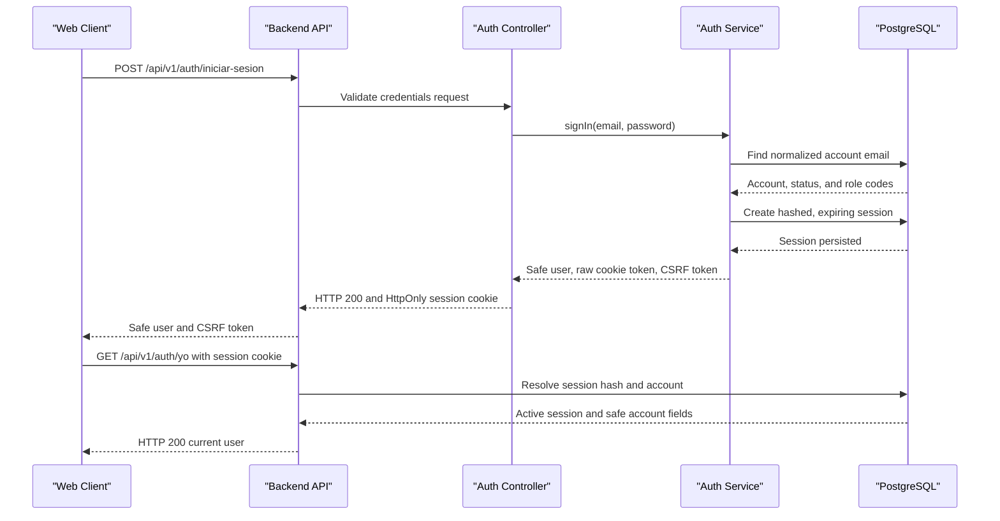

# API & Service Communication Contracts

The API exposes 19 endpoints: health, browser-session authentication, requester registration and provider invitations, requester review, and S.00 price requests. Attachments, the S.11/S.21/S.22 forms, audit queries, catalogue import over HTTP, provider pricing, and statistics do not yet have HTTP endpoints (see `docs/backlog-backend.md`). The machine-readable contract is the OpenAPI document served at `/api/v1/openapi.json` when `SWAGGER_ENABLED=true`.

## Service Catalog

| Service     | Port | Category       | Purpose                                                                  |
| ----------- | ---: | -------------- | ------------------------------------------------------------------------ |
| Backend API | 3000 | API Layer      | NestJS application; exposes health and session-authentication endpoints. |
| PostgreSQL  | 5432 | Infrastructure | Persistent store used by the backend schema.                             |

The [Compose configuration](../../../../../infra/docker-compose.yml) binds both ports to loopback for local use. NestJS feature modules for authentication, invitations, audit, attachments, and integrations are scaffolds, not independently deployed services.

## API Endpoints Inventory

| Service     | Method | Path                          | Request Type                              | Response Type                                                                    |
| ----------- | ------ | ----------------------------- | ----------------------------------------- | -------------------------------------------------------------------------------- |
| Backend API | GET    | `/api/v1/salud`                                  | None                                                | HTTP 200; JSON object with `estado` and `servicio`. |
| Backend API | POST   | `/api/v1/auth/iniciar-sesion`                    | `{ email, password }`                               | HTTP 200; safe `usuario` and `csrfToken`; sets the session cookie. |
| Backend API | GET    | `/api/v1/auth/yo`                                | Session cookie                                      | HTTP 200; current safe `usuario` and role codes. |
| Backend API | GET    | `/api/v1/auth/csrf`                              | Session cookie                                      | HTTP 200; a newly rotated `csrfToken`. |
| Backend API | POST   | `/api/v1/auth/cerrar-sesion`                     | Session cookie and `x-csrf-token`                   | HTTP 204; revokes the session and clears the cookie. |
| Backend API | POST   | `/api/v1/auth/registro-solicitante`              | `{ email, password, nombre, cargo?, institucion }`  | HTTP 202 with a generic message whether or not the email exists. |
| Backend API | POST   | `/api/v1/auth/verificar-correo`                  | `{ token }`                                         | HTTP 204; account moves to `PENDIENTE_APROBACION`. 400 `TOKEN_INVALIDO` otherwise. |
| Backend API | POST   | `/api/v1/auth/reenviar-verificacion`             | `{ email }`                                         | HTTP 202 generic message; previous tokens are invalidated. |
| Backend API | POST   | `/api/v1/auth/aceptar-invitacion`                | `{ token, password, nombre }`                       | HTTP 201; creates the `PROVEEDOR` account bound to the invited supplier. |
| Backend API | POST   | `/api/v1/invitaciones`                           | `ADMIN`; `{ email, proveedorId` or `nuevoProveedor }` | HTTP 201; `{ id, email, proveedorId, venceEn, correoEnviado }`, never the token. |
| Backend API | GET    | `/api/v1/solicitantes/pendientes`                | `ADMIN`                                             | HTTP 200; `{ solicitantes: [...] }` with verified-email, pending profiles. |
| Backend API | POST   | `/api/v1/solicitantes/{usuarioId}/aprobar`       | `ADMIN`, CSRF                                       | HTTP 200; `{ usuarioId, estado: ACTIVO }`. 409 `REVISION_NO_APLICABLE`. |
| Backend API | POST   | `/api/v1/solicitantes/{usuarioId}/rechazar`      | `ADMIN`, CSRF                                       | HTTP 200; `{ usuarioId, estado: DESACTIVADO }`. |
| Backend API | POST   | `/api/v1/solicitudes`                            | `SOLICITANTE`, CSRF; header fields and `productos`  | HTTP 201; draft request (`BORRADOR`) bound to the user and institution. |
| Backend API | GET    | `/api/v1/solicitudes`                            | `limite`, `desplazamiento`, `estado`                | HTTP 200; `{ total, solicitudes }` limited to the caller's scope. |
| Backend API | GET    | `/api/v1/solicitudes/{id}`                       | Session cookie                                      | HTTP 200; request with products. 404 for unknown or invisible requests. |
| Backend API | PATCH  | `/api/v1/solicitudes/{id}`                       | `SOLICITANTE` author, CSRF; partial fields          | HTTP 200; `productos`, when sent, replaces the whole list. 409 once sent. |
| Backend API | POST   | `/api/v1/solicitudes/{id}/enviar`                | `SOLICITANTE` author, CSRF                          | HTTP 200 and state `RECIBIDA`; 422 `SOLICITUD_INCOMPLETA` with per-field `errors`. |
| Backend API | POST   | `/api/v1/solicitudes/{id}/estado`                | `TRABAJADOR_INE` or `ADMIN`, CSRF; `{ estado, motivo? }` | HTTP 200; 409 `TRANSICION_NO_PERMITIDA` for an invalid transition. |

The response is currently `{"estado":"ok","servicio":"portal-precios-api"}`. This handler returns a static application status and does not check database connectivity; treat it as a liveness signal, not a readiness check.

Every error is `application/problem+json` (RFC 7807) with a stable `code`. Authentication failures return a generic HTTP 401 response, missing or invalid CSRF tokens on authenticated writes return HTTP 403, and a role mismatch also returns 403. Resources outside the caller's scope return 404 so their existence is not revealed. Validation errors use `VALIDACION_FALLIDA` with `errors: [{ field, message }]`.

## Management & Observability Endpoints

| Service     | Endpoint            | Custom Metrics |
| ----------- | ------------------- | -------------- |
| Backend API | `GET /api/v1/salud` | None           |

No separate metrics, tracing, or monitoring endpoint was found.

## DTOs & Contracts

Request bodies are validated by class-validator DTOs and described in the OpenAPI document (generated by the `@nestjs/swagger` compiler plugin, with controller-level security, error, and example metadata). The API has no GraphQL schema or protobuf definitions. `test/openapi.e2e-spec.ts` fails when an endpoint is added without documenting it. Authentication responses expose only the account ID, email, display name, and role codes; password hashes and raw session tokens are not returned in JSON.

Persisted entities and relationships belong to [data-architecture.md](./data-architecture.md). They are not automatically the HTTP contract: future API work should define separate request and response DTOs, explicitly control exposed fields, and publish status codes and error shapes before frontend integration.

## Communication Patterns

- Request flows are synchronous HTTP from a client to the NestJS API.
- The health handler calls an in-process service and does not access PostgreSQL.
- Sign-in and session operations use Prisma/PostgreSQL. Session and CSRF tokens are stored as SHA-256 hashes; session tokens are opaque random values held in an `HttpOnly` cookie.
- Authenticated state-changing requests require the session-bound `x-csrf-token` header. The CSRF endpoint rotates the token and invalidates the previously issued value.
- Cookies use `SameSite` configuration, `Secure` in production and whenever `SameSite=None`, and optional `COOKIE_DOMAIN`. CORS allows credentials only for configured origins.
- No asynchronous message broker, inter-service calls, retries, timeouts, circuit breakers, or service discovery were found.
- A global session guard protects non-public routes; health, sign-in, registration, email verification, verification resend, and invitation acceptance are explicitly public. The shared role guard (`@Roles`) and the fail-closed ownership helper are applied to requester review, invitations, and S.00 requests; resources outside the caller's scope return 404.
- CORS uses configured allowed origins. Helmet applies security headers, including Content Security Policy; HSTS is enabled only in production.
- The global validation pipe transforms input and rejects undeclared fields; sign-in uses a validated DTO.
- The default throttler limit is 100 requests per 60 seconds; sign-in is limited to five requests per minute and health skips throttling. No per-account policy is configured.
- `TRUSTED_PROXY_CIDRS` accepts explicit IP/CIDR entries; the application validates them before configuring Express trust-proxy behavior. Configure and verify the actual Cloudflare/proxy ranges before deployment.
- TLS termination is not configured in NestJS. The Compose ports are loopback-only for local use; production TLS and proxy configuration remain external deployment requirements.

## Service Technology Matrix

| Service     | Web           | Data Access                    | Discovery | Gateway | Health               | Cache | Metrics |
| ----------- | ------------- | ------------------------------ | --------- | ------- | -------------------- | ----- | ------- |
| Backend API | NestJS        | Prisma with PostgreSQL adapter | None      | None    | `GET /api/v1/salud`  | None  | None    |
| PostgreSQL  | PostgreSQL 16 | Native database                | None      | None    | Compose health check | None  | None    |

## Service Communication Sequence

<!-- mermaid-checked: every participant uses `participant Id as "Label"`, no \n in aliases/messages/notes, every alt/opt/loop closed by end, no `:` inside any alias -->

