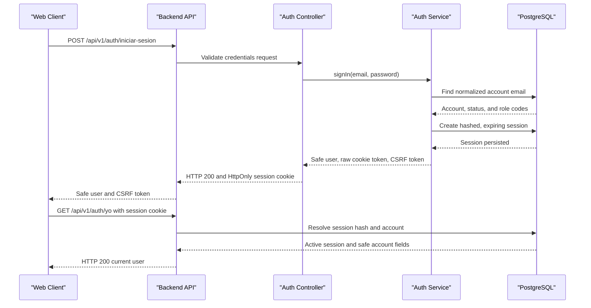

# API & Service Communication Contracts

The API exposes a public health endpoint and the first browser-session authentication flow. Request, registration, invitation, import, provider, and pricing workflows do not yet have HTTP endpoints.

## Service Catalog

| Service     | Port | Category       | Purpose                                                                  |
| ----------- | ---: | -------------- | ------------------------------------------------------------------------ |
| Backend API | 3000 | API Layer      | NestJS application; exposes health and session-authentication endpoints. |
| PostgreSQL  | 5432 | Infrastructure | Persistent store used by the backend schema.                             |

The [Compose configuration](../../../../../infra/docker-compose.yml) binds both ports to loopback for local use. NestJS feature modules for authentication, invitations, audit, attachments, and integrations are scaffolds, not independently deployed services.

## API Endpoints Inventory

| Service     | Method | Path                          | Request Type                              | Response Type                                                                    |
| ----------- | ------ | ----------------------------- | ----------------------------------------- | -------------------------------------------------------------------------------- |
| Backend API | GET    | `/api/v1/salud`               | None                                      | HTTP 200; JSON object with `estado` and `servicio`.                              |
| Backend API | POST   | `/api/v1/auth/iniciar-sesion` | `{ "email": string, "password": string }` | HTTP 200; safe `usuario` summary and `csrfToken`; sets the `ine_session` cookie. |
| Backend API | GET    | `/api/v1/auth/yo`             | `ine_session` cookie                      | HTTP 200; current safe `usuario` summary and role codes.                         |
| Backend API | GET    | `/api/v1/auth/csrf`           | `ine_session` cookie                      | HTTP 200; a newly rotated, session-bound `csrfToken`.                            |
| Backend API | POST   | `/api/v1/auth/cerrar-sesion`  | Session cookie and `x-csrf-token` header  | HTTP 204; revokes the session and clears the cookie.                             |

The response is currently `{"estado":"ok","servicio":"portal-precios-api"}`. This handler returns a static application status and does not check database connectivity; treat it as a liveness signal, not a readiness check.

Authentication failures return a generic HTTP 401 response. Missing or invalid CSRF tokens on authenticated writes return HTTP 403. Registration, email verification, invitations, requests, products, uploads, imports, commissions, quotations, and reports are not implemented.

## Management & Observability Endpoints

| Service     | Endpoint            | Custom Metrics |
| ----------- | ------------------- | -------------- |
| Backend API | `GET /api/v1/salud` | None           |

No separate metrics, tracing, or monitoring endpoint was found.

## DTOs & Contracts

`SignInDto` validates the sign-in request. The API has no OpenAPI/Swagger document, GraphQL schema, or protobuf definitions. Authentication responses expose only the account ID, email, display name, and role codes; password hashes and raw session tokens are not returned in JSON.

Persisted entities and relationships belong to [data-architecture.md](./data-architecture.md). They are not automatically the HTTP contract: future API work should define separate request and response DTOs, explicitly control exposed fields, and publish status codes and error shapes before frontend integration.

## Communication Patterns

- Request flows are synchronous HTTP from a client to the NestJS API.
- The health handler calls an in-process service and does not access PostgreSQL.
- Sign-in and session operations use Prisma/PostgreSQL. Session and CSRF tokens are stored as SHA-256 hashes; session tokens are opaque random values held in an `HttpOnly` cookie.
- Authenticated state-changing requests require the session-bound `x-csrf-token` header. The CSRF endpoint rotates the token and invalidates the previously issued value.
- Cookies use `SameSite` configuration, `Secure` in production and whenever `SameSite=None`, and optional `COOKIE_DOMAIN`. CORS allows credentials only for configured origins.
- No asynchronous message broker, inter-service calls, retries, timeouts, circuit breakers, or service discovery were found.
- A global session guard protects non-public routes; health and sign-in are explicitly public. A shared role guard and fail-closed resource-ownership helper are implemented, but no business endpoint currently applies those policies. No JWT or OAuth flow is used.
- CORS uses configured allowed origins. Helmet applies security headers, including Content Security Policy; HSTS is enabled only in production.
- The global validation pipe transforms input and rejects undeclared fields; sign-in uses a validated DTO.
- The default throttler limit is 100 requests per 60 seconds; sign-in is limited to five requests per minute and health skips throttling. No per-account policy is configured.
- `TRUSTED_PROXY_CIDRS` accepts explicit IP/CIDR entries; the application validates them before configuring Express trust-proxy behavior. Configure and verify the actual Cloudflare/proxy ranges before deployment.
- TLS termination is not configured in NestJS. The Compose ports are loopback-only for local use; production TLS and proxy configuration remain external deployment requirements.

## Service Technology Matrix

| Service     | Web           | Data Access                    | Discovery | Gateway | Health               | Cache | Metrics |
| ----------- | ------------- | ------------------------------ | --------- | ------- | -------------------- | ----- | ------- |
| Backend API | NestJS        | Prisma with PostgreSQL adapter | None      | None    | `GET /api/v1/salud`  | None  | None    |
| PostgreSQL  | PostgreSQL 16 | Native database                | None      | None    | Compose health check | None  | None    |

## Service Communication Sequence

<!-- mermaid-checked: every participant uses `participant Id as "Label"`, no \n in aliases/messages/notes, every alt/opt/loop closed by end, no `:` inside any alias -->

