# Data Architecture & Persistence Layer

The current Prisma schema contains 30 PostgreSQL models for identity, supplier catalogs, import provenance, INE references, and price requests. Prisma Migrate versions schema changes; the checked-in model is the source for this entity inventory.

## Database Configuration

| Service/Module | DB Type | Profile | Driver | Connection | Migration Tool |
|---|---|---|---|---|---|
| Backend API | PostgreSQL 16 | Local and Compose | Prisma PostgreSQL adapter backed by `pg` | Environment-provided database URL | Prisma Migrate |

PostgreSQL initialization enables `pg_trgm`, `unaccent`, and `vector`. The domain migration seeds roles and canonical procurement types. No separate database profiles, production connection profile, or cache are configured in the codebase.

## Data Ownership per Service

| Service | Tables Owned | ORM Framework | Caching | Notes |
|---|---|---|---|---|
| Identity and access | `usuarios`, `roles`, `usuarios_roles`, `tokens_verificacion_correo`, `sesiones_usuario`, `instituciones_solicitantes`, `perfiles_solicitantes`, `invitaciones_proveedor`, `eventos_auditoria` | Prisma | None | Session and requester identity persistence is defined; registration, review, invitations, and authorization workflows are not complete. |
| Supplier catalog | `proveedores`, `productos_proveedor`, `precios_proveedor` | Prisma | None | Price records preserve history. |
| Supplier imports | `importaciones_proveedor`, `filas_importacion_proveedor` | Prisma | None | Retains imported rows and processing state. |
| INE reference catalog | `importaciones_ine`, `filas_importacion_ine`, `tipos_modalidad`, `alias_modalidad`, `referencias_ine` | Prisma | None | Source rows and normalized references are distinct. |
| Price request and imported-goods case | `solicitudes_precio`, `productos_solicitud`, `requisitos_solicitud`, `solicitudes_adjuntos`, `proveedores_solicitud`, `proveedores_solicitud_productos`, `justificaciones_solicitud`, `comisiones_importacion`, `representantes_solicitante`, `cotizaciones_importacion`, `cotizaciones_productos` | Prisma | None | Persistence covers request and official form data; business endpoints and file storage are not complete. |

## Entity Model

All scalar columns in the current Prisma schema are listed below. `PK`, `FK`, and `UK` identify primary, foreign, and unique keys; `NULL` marks nullable columns. Names in brackets are physical PostgreSQL column names when they differ from Prisma field names.

| Entity / table | Attributes | Source |
|---|---|---|
| `Usuario` / `usuarios` | `id: UUID PK`; `email: VARCHAR(320) UK`; `passwordHash [password_hash]: VARCHAR(255)`; `nombre: VARCHAR(160)`; `estado: estado_usuario`; `proveedorId [proveedor_id]: UUID FK NULL -> Proveedor.id`; `emailVerificadoEn [email_verificado_en]: TIMESTAMPTZ(6) NULL`; `ultimoAccesoEn [ultimo_acceso_en]: TIMESTAMPTZ(6) NULL`; `createdAt [created_at]: TIMESTAMPTZ(6)`; `updatedAt [updated_at]: TIMESTAMPTZ(6)` | `prisma/schema.prisma` |
| `InstitucionSolicitante` / `instituciones_solicitantes` | `id: UUID PK`; `nombreOficial [nombre_oficial]: VARCHAR(240)`; `nit: VARCHAR(20) UK NULL`; `createdAt [created_at]: TIMESTAMPTZ(6)`; `updatedAt [updated_at]: TIMESTAMPTZ(6)` | `prisma/schema.prisma` |
| `PerfilSolicitante` / `perfiles_solicitantes` | `id: UUID PK`; `usuarioId [usuario_id]: UUID UK FK -> Usuario.id`; `institucionId [institucion_id]: UUID FK -> InstitucionSolicitante.id`; `cargo: VARCHAR(160) NULL`; `dpiCifrado [dpi_cifrado]: VARCHAR(512) NULL`; `estadoRevision [estado_revision]: estado_revision_solicitante`; `revisadoPorId [revisado_por_id]: UUID FK NULL -> Usuario.id`; `revisadoEn [revisado_en]: TIMESTAMPTZ(6) NULL`; `createdAt [created_at]: TIMESTAMPTZ(6)`; `updatedAt [updated_at]: TIMESTAMPTZ(6)` | `prisma/schema.prisma` |
| `Rol` / `roles` | `id: UUID PK`; `codigo: VARCHAR(40) UK`; `nombre: VARCHAR(80)`; `createdAt [created_at]: TIMESTAMPTZ(6)` | `prisma/schema.prisma` |
| `UsuarioRol` / `usuarios_roles` | `usuarioId [usuario_id]: UUID PK FK -> Usuario.id`; `rolId [rol_id]: UUID PK FK -> Rol.id`; `asignadoPorId [asignado_por_id]: UUID FK NULL -> Usuario.id`; `asignadoEn [asignado_en]: TIMESTAMPTZ(6)` | `prisma/schema.prisma` |
| `TokenVerificacionCorreo` / `tokens_verificacion_correo` | `id: UUID PK`; `usuarioId [usuario_id]: UUID FK -> Usuario.id`; `tokenHash [token_hash]: VARCHAR(64) UK`; `venceEn [vence_en]: TIMESTAMPTZ(6)`; `consumidoEn [consumido_en]: TIMESTAMPTZ(6) NULL`; `creadaEn [creada_en]: TIMESTAMPTZ(6)` | `prisma/schema.prisma` |
| `SesionUsuario` / `sesiones_usuario` | `id: UUID PK`; `usuarioId [usuario_id]: UUID FK -> Usuario.id`; `tokenHash [token_hash]: CHAR(64) UK`; `csrfTokenHash [csrf_token_hash]: CHAR(64)`; `venceEn [vence_en]: TIMESTAMPTZ(6)`; `revocadaEn [revocada_en]: TIMESTAMPTZ(6) NULL`; `creadaEn [creada_en]: TIMESTAMPTZ(6)`; `ultimoAccesoEn [ultimo_acceso_en]: TIMESTAMPTZ(6) NULL` | `prisma/schema.prisma` |
| `Proveedor` / `proveedores` | `id: UUID PK`; `nombreComercial [nombre_comercial]: VARCHAR(200)`; `razonSocial [razon_social]: VARCHAR(240) NULL`; `correoContacto [correo_contacto]: VARCHAR(320) NULL`; `estado: estado_proveedor`; `createdAt [created_at]: TIMESTAMPTZ(6)`; `updatedAt [updated_at]: TIMESTAMPTZ(6)` | `prisma/schema.prisma` |
| `InvitacionProveedor` / `invitaciones_proveedor` | `id: UUID PK`; `proveedorId [proveedor_id]: UUID FK NULL -> Proveedor.id`; `email: VARCHAR(320)`; `tokenHash [token_hash]: VARCHAR(64) UK`; `venceEn [vence_en]: TIMESTAMPTZ(6)`; `aceptadaEn [aceptada_en]: TIMESTAMPTZ(6) NULL`; `creadaPorId [creada_por_id]: UUID FK NULL -> Usuario.id`; `creadaEn [creada_en]: TIMESTAMPTZ(6)` | `prisma/schema.prisma` |
| `EventoAuditoria` / `eventos_auditoria` | `id: UUID PK`; `actorId [actor_id]: UUID FK NULL -> Usuario.id`; `accion: VARCHAR(100)`; `recurso: VARCHAR(100)`; `recursoId [recurso_id]: VARCHAR(100) NULL`; `metadatos: JSONB NULL`; `creadoEn [creado_en]: TIMESTAMPTZ(6)` | `prisma/schema.prisma` |
| `ProductoProveedor` / `productos_proveedor` | `id: UUID PK`; `proveedorId [proveedor_id]: UUID FK -> Proveedor.id`; `codigoProveedor [codigo_proveedor]: VARCHAR(100) NULL`; `nombre: VARCHAR(240)`; `descripcion: TEXT NULL`; `presentacion: VARCHAR(160) NULL`; `categoriaOriginal [categoria_original]: VARCHAR(160) NULL`; `atributos: JSONB NULL`; `estado: estado_producto_proveedor`; `createdAt [created_at]: TIMESTAMPTZ(6)`; `updatedAt [updated_at]: TIMESTAMPTZ(6)`; `UK (proveedor_id, codigo_proveedor)` | `prisma/schema.prisma` |
| `PrecioProveedor` / `precios_proveedor` | `id: UUID PK`; `productoProveedorId [producto_proveedor_id]: UUID FK -> ProductoProveedor.id`; `monto: DECIMAL(14, 3)`; `moneda: CHAR(3)`; `fechaPrecio [fecha_precio]: DATE NULL`; `vigenciaHasta [vigencia_hasta]: DATE NULL`; `registradoPorId [registrado_por_id]: UUID FK NULL -> Usuario.id`; `createdAt [created_at]: TIMESTAMPTZ(6)` | `prisma/schema.prisma` |
| `ImportacionProveedor` / `importaciones_proveedor` | `id: UUID PK`; `proveedorId [proveedor_id]: UUID FK -> Proveedor.id`; `nombreArchivo [nombre_archivo]: VARCHAR(255)`; `sha256: CHAR(64)`; `formato: formato_importacion`; `estado: estado_importacion`; `filasLeidas [filas_leidas]: INTEGER`; `filasAceptadas [filas_aceptadas]: INTEGER`; `filasConObservaciones [filas_con_observaciones]: INTEGER`; `filasRechazadas [filas_rechazadas]: INTEGER`; `iniciadaEn [iniciada_en]: TIMESTAMPTZ(6)`; `completadaEn [completada_en]: TIMESTAMPTZ(6) NULL`; `usuarioId [usuario_id]: UUID FK NULL -> Usuario.id`; `UK (proveedor_id, sha256)` | `prisma/schema.prisma` |
| `FilaImportacionProveedor` / `filas_importacion_proveedor` | `id: UUID PK`; `importacionId [importacion_id]: UUID FK -> ImportacionProveedor.id`; `numeroFila [numero_fila]: INTEGER`; `datosOriginales [datos_originales]: JSONB`; `estado: estado_fila_importacion`; `errores: JSONB NULL`; `productoProveedorId [producto_proveedor_id]: UUID FK NULL -> ProductoProveedor.id`; `precioProveedorId [precio_proveedor_id]: UUID UK FK NULL -> PrecioProveedor.id`; `createdAt [created_at]: TIMESTAMPTZ(6)`; `UK (importacion_id, numero_fila)` | `prisma/schema.prisma` |
| `ImportacionINE` / `importaciones_ine` | `id: UUID PK`; `nombreArchivo [nombre_archivo]: VARCHAR(255)`; `sha256: CHAR(64) UK`; `formato: formato_importacion`; `estado: estado_importacion`; `encabezadosOriginales [encabezados_originales]: JSONB NULL`; `filasLeidas [filas_leidas]: INTEGER`; `filasAceptadas [filas_aceptadas]: INTEGER`; `filasConObservaciones [filas_con_observaciones]: INTEGER`; `filasRechazadas [filas_rechazadas]: INTEGER`; `iniciadaEn [iniciada_en]: TIMESTAMPTZ(6)`; `completadaEn [completada_en]: TIMESTAMPTZ(6) NULL`; `usuarioId [usuario_id]: UUID FK NULL -> Usuario.id` | `prisma/schema.prisma` |
| `FilaImportacionINE` / `filas_importacion_ine` | `id: UUID PK`; `importacionId [importacion_id]: UUID FK -> ImportacionINE.id`; `numeroFila [numero_fila]: INTEGER`; `datosOriginales [datos_originales]: JSONB`; `estado: estado_fila_importacion`; `errores: JSONB NULL`; `createdAt [created_at]: TIMESTAMPTZ(6)`; `UK (importacion_id, numero_fila)` | `prisma/schema.prisma` |
| `TipoModalidad` / `tipos_modalidad` | `id: UUID PK`; `codigo: VARCHAR(80) UK`; `nombre: VARCHAR(160)`; `activo: BOOLEAN`; `createdAt [created_at]: TIMESTAMPTZ(6)` | `prisma/schema.prisma` |
| `AliasModalidad` / `alias_modalidad` | `id: UUID PK`; `valorOriginal [valor_original]: VARCHAR(240)`; `claveNormalizada [clave_normalizada]: VARCHAR(240) UK`; `tipoModalidadId [tipo_modalidad_id]: UUID FK NULL -> TipoModalidad.id`; `estado: estado_alias_modalidad`; `revisadoPorId [revisado_por_id]: UUID FK NULL -> Usuario.id`; `createdAt [created_at]: TIMESTAMPTZ(6)` | `prisma/schema.prisma` |
| `ReferenciaINE` / `referencias_ine` | `id: UUID PK`; `filaImportacionId [fila_importacion_id]: UUID UK FK -> FilaImportacionINE.id`; `tipoModalidadId [tipo_modalidad_id]: UUID FK NULL -> TipoModalidad.id`; `modalidadOriginal [modalidad_original]: VARCHAR(240) NULL`; `referenciaContrato [referencia_contrato]: VARCHAR(100) NULL`; `nog: VARCHAR(100) NULL`; `eventoOriginal [evento_original]: VARCHAR(240) NULL`; `correlativo: VARCHAR(100) NULL`; `producto: TEXT NULL`; `caracteristicas: TEXT NULL`; `presentacion: VARCHAR(240) NULL`; `precioReferencia [precio_referencia]: DECIMAL(14, 3) NULL`; `moneda: CHAR(3)`; `fechaPublicacion [fecha_publicacion]: DATE NULL`; `vigenciaHasta [vigencia_hasta]: DATE NULL`; `categoriaOriginal [categoria_original]: VARCHAR(240) NULL`; `createdAt [created_at]: TIMESTAMPTZ(6)`; `updatedAt [updated_at]: TIMESTAMPTZ(6)` | `prisma/schema.prisma` |
| `SolicitudPrecio` / `solicitudes_precio` | `id: UUID PK`; `titulo: VARCHAR(200)`; `institucionSolicitante [institucion_solicitante]: VARCHAR(240)`; `descripcion: TEXT`; `modalidad: modalidad_solicitud NULL`; `institucionSolicitanteId [institucion_solicitante_id]: UUID FK NULL -> InstitucionSolicitante.id`; `unidadEjecutora [unidad_ejecutora]: VARCHAR(240) NULL`; `fechaFormulario [fecha_formulario]: DATE NULL`; `enlaceNombre [enlace_nombre]: VARCHAR(160) NULL`; `enlaceCargo [enlace_cargo]: VARCHAR(160) NULL`; `autoridadNombre [autoridad_nombre]: VARCHAR(160) NULL`; `autoridadCargo [autoridad_cargo]: VARCHAR(160) NULL`; `estado: estado_solicitud`; `creadaPorId [creada_por_id]: UUID FK -> Usuario.id`; `createdAt [created_at]: TIMESTAMPTZ(6)`; `updatedAt [updated_at]: TIMESTAMPTZ(6)` | `prisma/schema.prisma` |
| `SolicitudAdjunto` / `solicitudes_adjuntos` | `id: UUID PK`; `solicitudId [solicitud_id]: UUID FK -> SolicitudPrecio.id`; `tipo: tipo_adjunto_solicitud`; `nombreOriginal [nombre_original]: VARCHAR(255)`; `objectKey [object_key]: VARCHAR(512) UK`; `mimeVerificado [mime_verificado]: VARCHAR(120)`; `tamanoBytes [tamano_bytes]: INTEGER`; `sha256: CHAR(64)`; `subidoPorId [subido_por_id]: UUID FK NULL -> Usuario.id`; `productoSolicitudId [producto_solicitud_id]: UUID FK NULL -> ProductoSolicitud.id`; `cotizacionId [cotizacion_id]: UUID FK NULL -> CotizacionImportacion.id`; `justificacionId [justificacion_id]: UUID FK NULL -> JustificacionSolicitud.id`; `createdAt [created_at]: TIMESTAMPTZ(6)` | `prisma/schema.prisma` |
| `RequisitoSolicitud` / `requisitos_solicitud` | `id: UUID PK`; `solicitudId [solicitud_id]: UUID FK -> SolicitudPrecio.id`; `nombre: VARCHAR(160)`; `valor: VARCHAR(500)`; `unidad: VARCHAR(80) NULL`; `modo: modo_requisito`; `obligatorio: BOOLEAN`; `fuente: fuente_requisito`; `estado: estado_requisito`; `aprobadoPorId [aprobado_por_id]: UUID FK NULL -> Usuario.id`; `createdAt [created_at]: TIMESTAMPTZ(6)`; `updatedAt [updated_at]: TIMESTAMPTZ(6)` | `prisma/schema.prisma` |
| `ProductoSolicitud` / `productos_solicitud` | `id: UUID PK`; `solicitudId [solicitud_id]: UUID FK -> SolicitudPrecio.id`; `numero: INTEGER`; `nombre: VARCHAR(240)`; `codigoSiges [codigo_siges]: VARCHAR(100) NULL`; `especificacionesTecnicas [especificaciones_tecnicas]: TEXT NULL`; `unidadMedida [unidad_medida]: VARCHAR(120) NULL`; `cantidad: DECIMAL(14, 3) NULL`; `createdAt [created_at]: TIMESTAMPTZ(6)`; `updatedAt [updated_at]: TIMESTAMPTZ(6)`; `UK (solicitud_id, numero)` | `prisma/schema.prisma` |
| `ComisionImportacion` / `comisiones_importacion` | `id: UUID PK`; `solicitudId [solicitud_id]: UUID UK FK -> SolicitudPrecio.id`; `estado: estado_comision_importacion`; `formadaEn [formada_en]: TIMESTAMPTZ(6) NULL`; `createdAt [created_at]: TIMESTAMPTZ(6)`; `updatedAt [updated_at]: TIMESTAMPTZ(6)` | `prisma/schema.prisma` |
| `RepresentanteSolicitante` / `representantes_solicitante` | `id: UUID PK`; `comisionId [comision_id]: UUID FK -> ComisionImportacion.id`; `tipo: tipo_representante_solicitante`; `nombre: VARCHAR(160)`; `correo: VARCHAR(320)`; `telefono: VARCHAR(40)`; `direccionNotificaciones [direccion_notificaciones]: VARCHAR(500)`; `createdAt [created_at]: TIMESTAMPTZ(6)`; `updatedAt [updated_at]: TIMESTAMPTZ(6)`; `UK (comision_id, tipo)` | `prisma/schema.prisma` |
| `CotizacionImportacion` / `cotizaciones_importacion` | `id: UUID PK`; `comisionId [comision_id]: UUID FK -> ComisionImportacion.id`; `numero: INTEGER`; `numeroCotizacion [numero_cotizacion]: VARCHAR(120) NULL`; `proveedorNombre [proveedor_nombre]: VARCHAR(240)`; `sitioWeb [sitio_web]: VARCHAR(500) NULL`; `correoProveedor [correo_proveedor]: VARCHAR(320) NULL`; `codigoPaisTelefono [codigo_pais_telefono]: VARCHAR(8) NULL`; `telefonoProveedor [telefono_proveedor]: VARCHAR(40) NULL`; `fechaConsulta [fecha_consulta]: DATE NULL`; `createdAt [created_at]: TIMESTAMPTZ(6)`; `UK (comision_id, numero)` | `prisma/schema.prisma` |
| `CotizacionProducto` / `cotizaciones_productos` | `id: UUID PK`; `cotizacionId [cotizacion_id]: UUID FK -> CotizacionImportacion.id`; `productoSolicitudId [producto_solicitud_id]: UUID FK -> ProductoSolicitud.id`; `especificacionesCotizacion [especificaciones_cotizacion]: TEXT NULL`; `fabricante: VARCHAR(240) NULL`; `paisOrigen [pais_origen]: VARCHAR(120) NULL`; `moneda: CHAR(3)`; `precioFobTotal [precio_fob_total]: DECIMAL(14, 3)`; `flete: DECIMAL(14, 3) NULL`; `seguro: DECIMAL(14, 3) NULL`; `otrosGastos [otros_gastos]: DECIMAL(14, 3) NULL`; `createdAt [created_at]: TIMESTAMPTZ(6)`; `UK (cotizacion_id, producto_solicitud_id)` | `prisma/schema.prisma` |
| `JustificacionSolicitud` / `justificaciones_solicitud` | `id: UUID PK`; `solicitudId [solicitud_id]: UUID FK -> SolicitudPrecio.id`; `productoSolicitudId [producto_solicitud_id]: UUID FK NULL -> ProductoSolicitud.id`; `tipo: tipo_justificacion_solicitud`; `motivo: TEXT`; `autoridadNombre [autoridad_nombre]: VARCHAR(160)`; `autoridadCargo [autoridad_cargo]: VARCHAR(160)`; `creadaPorId [creada_por_id]: UUID FK NULL -> Usuario.id`; `createdAt [created_at]: TIMESTAMPTZ(6)` | `prisma/schema.prisma` |
| `ProveedorSolicitud` / `proveedores_solicitud` | `id: UUID PK`; `solicitudId [solicitud_id]: UUID FK -> SolicitudPrecio.id`; `proveedorId [proveedor_id]: UUID FK NULL -> Proveedor.id`; `nombreRazonSocial [nombre_razon_social]: VARCHAR(240)`; `nit: VARCHAR(40) NULL`; `direccion: VARCHAR(500) NULL`; `telefono: VARCHAR(40) NULL`; `estado: estado_proveedor_solicitud`; `confirmadoPorId [confirmado_por_id]: UUID FK NULL -> Usuario.id`; `confirmadoEn [confirmado_en]: TIMESTAMPTZ(6) NULL`; `createdAt [created_at]: TIMESTAMPTZ(6)` | `prisma/schema.prisma` |
| `ProveedorSolicitudProducto` / `proveedores_solicitud_productos` | `proveedorSolicitudId [proveedor_solicitud_id]: UUID PK FK -> ProveedorSolicitud.id`; `productoSolicitudId [producto_solicitud_id]: UUID PK FK -> ProductoSolicitud.id`; `createdAt [created_at]: TIMESTAMPTZ(6)` | `prisma/schema.prisma` |

Model attributes are persisted columns; enum values, defaults, indexes, composite unique constraints, and referential actions are defined in the Prisma schema and migrations. Prisma relation fields themselves are not columns.

```mermaid
erDiagram
    Proveedor o|--o{ Usuario : "proveedorId"
    Usuario ||--o{ PerfilSolicitante : "usuarioId"
    InstitucionSolicitante ||--o{ PerfilSolicitante : "institucionId"
    Usuario o|--o{ PerfilSolicitante : "revisadoPorId"
    Usuario ||--o{ UsuarioRol : "usuarioId"
    Rol ||--o{ UsuarioRol : "rolId"
    Usuario o|--o{ UsuarioRol : "asignadoPorId"
    Usuario ||--o{ TokenVerificacionCorreo : "usuarioId"
    Usuario ||--o{ SesionUsuario : "usuarioId"
    Proveedor o|--o{ InvitacionProveedor : "proveedorId"
    Usuario o|--o{ InvitacionProveedor : "creadaPorId"
    Usuario o|--o{ EventoAuditoria : "actorId"
    Proveedor ||--o{ ProductoProveedor : "proveedorId"
    ProductoProveedor ||--o{ PrecioProveedor : "productoProveedorId"
    Usuario o|--o{ PrecioProveedor : "registradoPorId"
    Proveedor ||--o{ ImportacionProveedor : "proveedorId"
    Usuario o|--o{ ImportacionProveedor : "usuarioId"
    ImportacionProveedor ||--o{ FilaImportacionProveedor : "importacionId"
    ProductoProveedor o|--o{ FilaImportacionProveedor : "productoProveedorId"
    PrecioProveedor o|--o{ FilaImportacionProveedor : "precioProveedorId"
    Usuario o|--o{ ImportacionINE : "usuarioId"
    ImportacionINE ||--o{ FilaImportacionINE : "importacionId"
    TipoModalidad o|--o{ AliasModalidad : "tipoModalidadId"
    Usuario o|--o{ AliasModalidad : "revisadoPorId"
    FilaImportacionINE ||--o{ ReferenciaINE : "filaImportacionId"
    TipoModalidad o|--o{ ReferenciaINE : "tipoModalidadId"
    Usuario ||--o{ SolicitudPrecio : "creadaPorId"
    InstitucionSolicitante o|--o{ SolicitudPrecio : "institucionSolicitanteId"
    SolicitudPrecio ||--o{ SolicitudAdjunto : "solicitudId"
    Usuario o|--o{ SolicitudAdjunto : "subidoPorId"
    ProductoSolicitud o|--o{ SolicitudAdjunto : "productoSolicitudId"
    CotizacionImportacion o|--o{ SolicitudAdjunto : "cotizacionId"
    JustificacionSolicitud o|--o{ SolicitudAdjunto : "justificacionId"
    SolicitudPrecio ||--o{ RequisitoSolicitud : "solicitudId"
    Usuario o|--o{ RequisitoSolicitud : "aprobadoPorId"
    SolicitudPrecio ||--o{ ProductoSolicitud : "solicitudId"
    SolicitudPrecio ||--o{ ComisionImportacion : "solicitudId"
    ComisionImportacion ||--o{ RepresentanteSolicitante : "comisionId"
    ComisionImportacion ||--o{ CotizacionImportacion : "comisionId"
    CotizacionImportacion ||--o{ CotizacionProducto : "cotizacionId"
    ProductoSolicitud ||--o{ CotizacionProducto : "productoSolicitudId"
    SolicitudPrecio ||--o{ JustificacionSolicitud : "solicitudId"
    ProductoSolicitud o|--o{ JustificacionSolicitud : "productoSolicitudId"
    Usuario o|--o{ JustificacionSolicitud : "creadaPorId"
    SolicitudPrecio ||--o{ ProveedorSolicitud : "solicitudId"
    Proveedor o|--o{ ProveedorSolicitud : "proveedorId"
    Usuario o|--o{ ProveedorSolicitud : "confirmadoPorId"
    ProveedorSolicitud ||--o{ ProveedorSolicitudProducto : "proveedorSolicitudId"
    ProductoSolicitud ||--o{ ProveedorSolicitudProducto : "productoSolicitudId"
    Usuario {
        uuid id PK
        string email UK
        uuid proveedorId FK
    }
    InstitucionSolicitante {
        uuid id PK
        string nit UK
    }
    PerfilSolicitante {
        uuid id PK
        uuid usuarioId FK
        uuid institucionId FK
        uuid revisadoPorId FK
    }
    Rol {
        uuid id PK
        string codigo UK
    }
    UsuarioRol {
        uuid usuarioId PK "also FK to Usuario.id"
        uuid rolId PK "also FK to Rol.id"
        uuid asignadoPorId FK
    }
    TokenVerificacionCorreo {
        uuid id PK
        uuid usuarioId FK
        string tokenHash UK
    }
    SesionUsuario {
        uuid id PK
        uuid usuarioId FK
        string tokenHash UK
    }
    Proveedor {
        uuid id PK
    }
    InvitacionProveedor {
        uuid id PK
        uuid proveedorId FK
        string tokenHash UK
        uuid creadaPorId FK
    }
    EventoAuditoria {
        uuid id PK
        uuid actorId FK
    }
    ProductoProveedor {
        uuid id PK
        uuid proveedorId FK
    }
    PrecioProveedor {
        uuid id PK
        uuid productoProveedorId FK
        uuid registradoPorId FK
    }
    ImportacionProveedor {
        uuid id PK
        uuid proveedorId FK
        uuid usuarioId FK
    }
    FilaImportacionProveedor {
        uuid id PK
        uuid importacionId FK
        uuid productoProveedorId FK
        uuid precioProveedorId FK
    }
    ImportacionINE {
        uuid id PK
        string sha256 UK
        uuid usuarioId FK
    }
    FilaImportacionINE {
        uuid id PK
        uuid importacionId FK
    }
    TipoModalidad {
        uuid id PK
        string codigo UK
    }
    AliasModalidad {
        uuid id PK
        string claveNormalizada UK
        uuid tipoModalidadId FK
        uuid revisadoPorId FK
    }
    ReferenciaINE {
        uuid id PK
        uuid filaImportacionId FK
        uuid tipoModalidadId FK
    }
    SolicitudPrecio {
        uuid id PK
        uuid institucionSolicitanteId FK
        uuid creadaPorId FK
    }
    SolicitudAdjunto {
        uuid id PK
        uuid solicitudId FK
        string objectKey UK
        uuid subidoPorId FK
        uuid productoSolicitudId FK
        uuid cotizacionId FK
        uuid justificacionId FK
    }
    RequisitoSolicitud {
        uuid id PK
        uuid solicitudId FK
        uuid aprobadoPorId FK
    }
    ProductoSolicitud {
        uuid id PK
        uuid solicitudId FK
    }
    ComisionImportacion {
        uuid id PK
        uuid solicitudId FK
    }
    RepresentanteSolicitante {
        uuid id PK
        uuid comisionId FK
    }
    CotizacionImportacion {
        uuid id PK
        uuid comisionId FK
    }
    CotizacionProducto {
        uuid id PK
        uuid cotizacionId FK
        uuid productoSolicitudId FK
    }
    JustificacionSolicitud {
        uuid id PK
        uuid solicitudId FK
        uuid productoSolicitudId FK
        uuid creadaPorId FK
    }
    ProveedorSolicitud {
        uuid id PK
        uuid solicitudId FK
        uuid proveedorId FK
        uuid confirmadoPorId FK
    }
    ProveedorSolicitudProducto {
        uuid proveedorSolicitudId PK "also FK to ProveedorSolicitud.id"
        uuid productoSolicitudId PK "also FK to ProductoSolicitud.id"
    }
```

<!-- mermaid-checked: every attribute is `<type> <name> [<key>] ["<description>"]` with at most one of PK/FK/UK, no \n in descriptions, no {} in descriptions, every relationship label is double-quoted -->

## Key Repository Methods

| Service | Repository | Notable Methods | Purpose |
|---|---|---|---|
| Backend API | No feature repositories defined | None | The global `PrismaService` exposes the generated Prisma client; authentication accesses it directly. |

## Caching Strategy

No application, query-result, or distributed cache is configured.

## Data Ownership Boundaries

All 30 models use a single PostgreSQL database through the NestJS application and Prisma. There are no separately deployed data-owning services or cross-service database calls. Foreign keys express persistence ownership and cascade behavior; authorization by role and record owner must be enforced in application services and is not implied by these relations. No CQRS read store is configured.

### Data Classification & Sensitivity

| Entity | Sensitive Fields | Classification | Controls in Place |
|---|---|---|---|
| `Usuario` | Email, name, password hash | PII and authentication data | Password hash column exists; credential verification uses Argon2id. No field encryption or masking is configured. |
| `PerfilSolicitante` | Optional DPI/CUI field | PII | The nullable persistence field exists, but application encryption, capture, masking, review access controls, and retention are not implemented; production collection remains gated. |
| `InstitucionSolicitante` | Official institution name, NIT | Organizational identifier | No field encryption or masking configured. |
| `Proveedor`, `InvitacionProveedor` | Contact email, legal/business name, invitation email and token hash | Business/contact and authentication data | Invitation tokens are represented by hashes; no field encryption or masking configured. |
| `SesionUsuario`, `TokenVerificacionCorreo` | Session, CSRF, and verification token hashes | Authentication data | Raw session and CSRF tokens are not persisted; stored token values are hashes. |
| `RepresentanteSolicitante`, `CotizacionImportacion`, `JustificacionSolicitud`, `ProveedorSolicitud` | Names, emails, phone numbers, addresses, supplier identifiers | PII or business-contact data | No application-level field encryption or masking configured. |
| `EventoAuditoria` and import rows | Actor identifiers, metadata, source-provided values | Depends on event or imported content | Access and redaction rules depend on future service controls; imported data is retained as JSONB. |
| `SolicitudAdjunto` | Object key, filename, content metadata | Potentially sensitive document metadata | File bytes are not stored in PostgreSQL; private object storage and authorization are not implemented. |
