# Data Architecture & Persistence Layer

The persistence layer uses PostgreSQL and Prisma across 27 models for identity, supplier data, import provenance, official references, and request workflows. Analysis and reporting persistence remain future work.

## Database Configuration

| Service/Module | DB Type | Profile | Driver | Connection | Migration Tool |
|---|---|---|---|---|---|
| Backend API | PostgreSQL 16 | Local and Compose | Prisma PostgreSQL adapter with `pg` | `DATABASE_URL` from environment | Prisma Migrate |

PostgreSQL initialization enables `pg_trgm`, `unaccent`, and `vector`. The domain migration seeds four roles and three canonical procurement types. There is no separate seed command or configured cache.

## Data Ownership per Service

| Service | Tables Owned | ORM Framework | Caching | Notes |
|---|---|---|---|---|
| Identity and access schema | `usuarios`, `roles`, `usuarios_roles`, `tokens_verificacion_correo`, `invitaciones_proveedor`, `eventos_auditoria` | Prisma | None | Persistence is defined; authentication and authorization services are not implemented. |
| Supplier catalog and imports | `proveedores`, `productos_proveedor`, `precios_proveedor`, `importaciones_proveedor`, `filas_importacion_proveedor` | Prisma | None | Price changes append history; original import rows are retained. |
| Official reference catalog | `importaciones_ine`, `filas_importacion_ine`, `tipos_modalidad`, `alias_modalidad`, `referencias_ine` | Prisma | None | Unknown values can remain unclassified while the original row is preserved. |
| Price requests | `solicitudes_precio`, `productos_solicitud`, `solicitudes_adjuntos`, `requisitos_solicitud`, `comisiones_importacion`, `representantes_solicitante`, `cotizaciones_importacion`, `cotizaciones_productos`, `justificaciones_solicitud`, `proveedores_solicitud`, `proveedores_solicitud_productos` | Prisma | None | Supports S.00/S.11/S.21/S.22 data; validation and HTTP services are not implemented. |

The NestJS feature modules remain scaffolds; these ownership areas describe the persistence model, not finished service implementations.

## Entity Model

Models and relations are defined in `prisma/schema.prisma`. Raw import headers and rows are stored separately from normalized reference fields so source variations and duplicate column names can be retained. Request records support the three modalities and the distinct supplier-list and imported-goods commission workflows.

```mermaid
erDiagram
    Proveedor ||--o{ Usuario : "has accounts"
    Usuario ||--o{ UsuarioRol : "has roles"
    Rol ||--o{ UsuarioRol : "assigned to"
    Usuario ||--o{ TokenVerificacionCorreo : "has tokens"
    Proveedor o|--o{ InvitacionProveedor : "is invited"
    Usuario o|--o{ InvitacionProveedor : "creates"
    Usuario o|--o{ EventoAuditoria : "acts"
    Proveedor ||--o{ ProductoProveedor : "offers"
    ProductoProveedor ||--o{ PrecioProveedor : "has price history"
    Usuario o|--o{ PrecioProveedor : "records"
    Proveedor ||--o{ ImportacionProveedor : "uploads"
    Usuario o|--o{ ImportacionProveedor : "starts"
    ImportacionProveedor ||--o{ FilaImportacionProveedor : "contains"
    ProductoProveedor o|--o{ FilaImportacionProveedor : "may match"
    PrecioProveedor o|--o| FilaImportacionProveedor : "may result from"
    Usuario o|--o{ ImportacionINE : "starts"
    ImportacionINE ||--o{ FilaImportacionINE : "contains"
    FilaImportacionINE ||--o| ReferenciaINE : "normalizes to"
    TipoModalidad o|--o{ AliasModalidad : "classifies"
    Usuario o|--o{ AliasModalidad : "reviews"
    TipoModalidad o|--o{ ReferenciaINE : "classifies"
    Usuario ||--o{ SolicitudPrecio : "creates"
    SolicitudPrecio ||--o{ SolicitudAdjunto : "has"
    Usuario o|--o{ SolicitudAdjunto : "uploads"
    SolicitudPrecio ||--o{ RequisitoSolicitud : "defines"
    Usuario o|--o{ RequisitoSolicitud : "approves"
    SolicitudPrecio ||--o{ ProductoSolicitud : "includes"
    SolicitudPrecio ||--o{ ProveedorSolicitud : "has suppliers"
    ProveedorSolicitud ||--o{ ProveedorSolicitudProducto : "covers"
    ProductoSolicitud ||--o{ ProveedorSolicitudProducto : "has supplier links"
    SolicitudPrecio ||--o{ JustificacionSolicitud : "documents exception"
    ProductoSolicitud o|--o{ JustificacionSolicitud : "may be justified"
    Usuario o|--o{ JustificacionSolicitud : "records"
    SolicitudPrecio ||--o| ComisionImportacion : "may open"
    ComisionImportacion ||--o{ RepresentanteSolicitante : "appoints"
    ComisionImportacion ||--o{ CotizacionImportacion : "collects"
    CotizacionImportacion ||--o{ CotizacionProducto : "contains"
    ProductoSolicitud ||--o{ CotizacionProducto : "is quoted"
    ProductoSolicitud o|--o{ SolicitudAdjunto : "may have files"
    CotizacionImportacion o|--o{ SolicitudAdjunto : "has evidence"
    JustificacionSolicitud o|--o{ SolicitudAdjunto : "has support"
    Proveedor o|--o{ ProveedorSolicitud : "may be linked"
    Usuario o|--o{ ProveedorSolicitud : "confirms"
    Usuario {
        uuid id PK
        string email UK
        string passwordHash
        uuid proveedorId FK
        string estado
        datetime createdAt
        datetime updatedAt
    }
    Rol {
        uuid id PK
        string codigo UK
        string nombre
    }
    UsuarioRol {
        uuid usuarioId PK
        uuid rolId PK
        uuid asignadoPorId FK
        datetime asignadoEn
    }
    TokenVerificacionCorreo {
        uuid id PK
        uuid usuarioId FK
        string tokenHash UK
        datetime venceEn
        datetime consumidoEn
    }
    Proveedor {
        uuid id PK
        string nombreComercial
        string estado
        datetime createdAt
        datetime updatedAt
    }
    InvitacionProveedor {
        uuid id PK
        uuid proveedorId FK
        uuid creadaPorId FK
        string email
        string tokenHash UK
        datetime venceEn
    }
    EventoAuditoria {
        uuid id PK
        uuid actorId FK
        string accion
        string recurso
        string recursoId
        json metadatos
    }
    ProductoProveedor {
        uuid id PK
        uuid proveedorId FK
        string codigoProveedor
        string nombre
        json atributos
        string estado
        datetime updatedAt
    }
    PrecioProveedor {
        uuid id PK
        uuid productoProveedorId FK
        decimal monto
        string moneda
        date fechaPrecio
        date vigenciaHasta
        datetime createdAt
    }
    ImportacionProveedor {
        uuid id PK
        uuid proveedorId FK
        string sha256
        string formato
        string estado
    }
    FilaImportacionProveedor {
        uuid id PK
        uuid importacionId FK
        uuid productoProveedorId FK
        uuid precioProveedorId UK
        int numeroFila
        json datosOriginales
        json errores
    }
    ImportacionINE {
        uuid id PK
        uuid usuarioId FK
        string sha256 UK
        string formato
        string estado
        json encabezadosOriginales
    }
    FilaImportacionINE {
        uuid id PK
        uuid importacionId FK
        int numeroFila
        json datosOriginales
        json errores
    }
    TipoModalidad {
        uuid id PK
        string codigo UK
        string nombre
        bool activo
    }
    AliasModalidad {
        uuid id PK
        string claveNormalizada UK
        uuid tipoModalidadId FK
        uuid revisadoPorId FK
        string estado
    }
    ReferenciaINE {
        uuid id PK
        uuid filaImportacionId UK
        uuid tipoModalidadId FK
        string modalidadOriginal
        string referenciaContrato
        string nog
        string eventoOriginal
        string producto
        decimal precioReferencia
        date fechaPublicacion
        date vigenciaHasta
    }
    SolicitudPrecio {
        uuid id PK
        uuid creadaPorId FK
        string titulo
        string institucionSolicitante
        string modalidad
        string unidadEjecutora
        string estado
        datetime createdAt
        datetime updatedAt
    }
    SolicitudAdjunto {
        uuid id PK
        uuid solicitudId FK
        uuid subidoPorId FK
        uuid productoSolicitudId FK
        uuid cotizacionId FK
        uuid justificacionId FK
        string objectKey UK
        string tipo
        string mimeVerificado
        int tamanoBytes
        string sha256
    }
    RequisitoSolicitud {
        uuid id PK
        uuid solicitudId FK
        uuid aprobadoPorId FK
        string nombre
        string valor
        string modo
        string fuente
        string estado
    }
    ProductoSolicitud {
        uuid id PK
        uuid solicitudId FK
        int numero
        string nombre
        string codigoSiges
        string especificacionesTecnicas
        string unidadMedida
        decimal cantidad
    }
    ComisionImportacion {
        uuid id PK
        uuid solicitudId UK
        string estado
        datetime formadaEn
    }
    RepresentanteSolicitante {
        uuid id PK
        uuid comisionId FK
        string tipo
        string nombre
        string correo
        string telefono
        string direccionNotificaciones
    }
    CotizacionImportacion {
        uuid id PK
        uuid comisionId FK
        int numero
        string proveedorNombre
        string correoProveedor
        string codigoPaisTelefono
        string telefonoProveedor
        date fechaConsulta
    }
    CotizacionProducto {
        uuid id PK
        uuid cotizacionId FK
        uuid productoSolicitudId FK
        string fabricante
        string paisOrigen
        string moneda
        decimal precioFobTotal
        decimal flete
        decimal seguro
        decimal otrosGastos
    }
    JustificacionSolicitud {
        uuid id PK
        uuid solicitudId FK
        uuid productoSolicitudId FK
        uuid creadaPorId FK
        string tipo
        string motivo
        string autoridadNombre
        string autoridadCargo
    }
    ProveedorSolicitud {
        uuid id PK
        uuid solicitudId FK
        uuid proveedorId FK
        uuid confirmadoPorId FK
        string nombreRazonSocial
        string nit
        string estado
    }
    ProveedorSolicitudProducto {
        uuid proveedorSolicitudId PK
        uuid productoSolicitudId PK
        datetime createdAt
    }
```

<!-- mermaid-checked: every attribute is `<type> <name> [<key>] ["<description>"]` with at most one of PK/FK/UK, no \n in descriptions, no {} in descriptions, every relationship label is double-quoted -->

## Key Repository Methods

| Service | Repository | Notable Methods | Purpose |
|---|---|---|---|
| Backend API | None defined | None | `PrismaService` exposes the generated Prisma client; feature repositories have not been implemented. |

## Caching Strategy

No application, query-result, or distributed cache is configured.

## Data Ownership Boundaries

All current entities share one PostgreSQL database and are accessed through the backend's Prisma service. The schema provides foreign-key boundaries, but endpoint-level authorization and provider ownership checks are not implemented yet.

### Data Classification & Sensitivity

| Entity | Sensitive Fields | Classification (PII/PHI/PCI/None) | Controls in Place |
|---|---|---|---|
| `Usuario` | `email`, `nombre`, `passwordHash` | PII and authentication data | Hash field is defined; password hashing and field-level encryption are not implemented/configured. |
| `Proveedor` | `correoContacto`, `razonSocial` | Potentially identifying business/contact data | No field-level encryption or masking is configured. |
| `InvitacionProveedor`, `TokenVerificacionCorreo` | `email`, `tokenHash` | PII and authentication data | Tokens are stored as hashes; no field-level encryption or masking is configured. |
| `EventoAuditoria` | `actorId`, `metadatos` | Potentially identifying data | No field-level encryption or masking is configured. |
| `RepresentanteSolicitante`, `JustificacionSolicitud` | Names, emails, phones, notification addresses, authority details | PII | Access control is not implemented; no field-level encryption or masking is configured. |
| `ProveedorSolicitud`, `CotizacionImportacion` | Tax identifier, address, phone, supplier contact details | Business/contact data, potentially identifying | Access control is not implemented; no field-level encryption or masking is configured. |
| Import rows and attachments | Source-provided values and file metadata | Depends on uploaded content | Original files are not stored in PostgreSQL; access controls and storage encryption remain to be implemented. |
